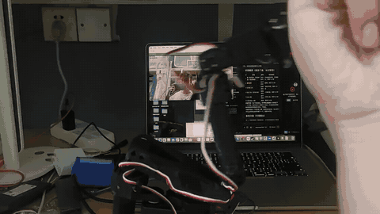

# 五自由度机械臂（含夹爪） · 远程控制系统

一台 3D 打印的机械臂，支持**公网网页遥控**与**手势识别控制**，从硬件驱动到云端服务完整自建。



> 摄像头识别手势 → 直接驱动六个总线舵机。左边是手势预览窗，右边是网页遥控台。
> 完整 65 秒演示见 [docs/demo.mp4](docs/demo.mp4)（含位置跟随模式）。

---

## 功能特性

| 功能 | 说明 |
|---|---|
| 🌐 **公网远程控制** | ESP32 主动连出，无需公网 IP、不用端口映射，随时随地用网页控制 |
| ✋ **手势识别控制** | 摄像头识别手势驱动机械臂，支持指令模式与位置跟随 |
| 🖥️ **Web 遥控台** | Vue 3 单页应用，滑块、预设姿态、精细微调 |
| 💬 **配套官网** | 首页 / 留言板 / 下载页，支持 PWA 安装到手机 |
| 📖 **在线 API 文档** | OpenAPI 3.0 + Swagger UI，可在线调试 |
| 🔧 **力反馈** | 总线舵机回传负载/电流，力反馈仪表盘、碰撞感知与逐关节过载/过温/低压保护已上线；过载阈值已实测标定 |

---

## 系统架构

```
┌─────────────────────────────────────────────────────┐
│  应用层    Vue 3 网页遥控  │  Python 手势识别            │
└──────────────────────┬──────────────────────────────┘
                       │ HTTP
┌──────────────────────▼──────────────────────────────┐
│  云服务层   Node.js + Express + WebSocket 中转         │
│            MySQL 数据持久化  │  OpenAPI 接口文档         │
└──────────────────────┬──────────────────────────────┘
                       │ WebSocket 长连接
┌──────────────────────▼──────────────────────────────┐
│  嵌入式层   ESP32-S3 固件（C++ / Arduino）             │
│            自实现的 STS / SCS 协议栈                   │
└──────────────────────┬──────────────────────────────┘
                       │ TTL 半双工串口 · 1Mbps
┌──────────────────────▼──────────────────────────────┐
│  硬件层     总线舵机转接板 (H2)  │  STS3215 × 6       │
│            3S 锂电 12.6V 直通  │  SO-ARM101 打印件    │
└─────────────────────────────────────────────────────┘
```

**为什么需要服务器中转？**
ESP32 在局域网里、没有公网 IP。让它**主动连出去**并保持长连接，服务器就能顺着这条连接把浏览器命令转发进来 —— 不需要端口映射，也不用内网穿透。这是物联网设备的标准做法。

> 完整技术说明见 **[技术文档.md](技术文档.md)** —— 包含从拖动滑块到舵机转动的完整数据流追踪。
> 上机调试的踩坑过程见 **[演进记录.md](演进记录.md)**。

---

## 快速开始

### 1. 启动服务器

```bash
cd server
npm run setup      # 安装前后端依赖
mysql -u root < schema.sql   # 建库建表（首次）
npm run build      # 构建前端
npm start
```

浏览器打开 http://localhost:3000

### 2. 烧录固件

```bash
cd arm-cloud
cp secrets.h.example secrets.h   # 填入 WiFi 和服务器地址
```

用 Arduino IDE 打开 `arm-cloud.ino` 烧录（开发板选 **ESP32S3 Dev Module**）。

### 3. 手势控制（可选）

```bash
cd gesture-control
uv run smoke_test.py        # 自检环境
uv run gesture_control.py   # 启动
```

---

## 目录导航

| 目录 | 内容 | 文档 |
|---|---|---|
| [`server/`](server/) | 云控服务器 + 产品官网（Node + MySQL + Vue） | [README](server/README.md) · [数据库设计](server/DATABASE.md) |
| [`server/web/`](server/web/) | Vue 3 遥控台前端 | [README](server/web/README.md) |
| [`gesture-control/`](gesture-control/) | 手势识别控制（Python + MediaPipe） | [README](gesture-control/README.md) |
| [`arm-cloud-bus/`](arm-cloud-bus/) | **云连接 + 总线舵机**（当前主线） | — |
| [`arm-bus-servo/`](arm-bus-servo/) | 总线舵机固件（含串口调试命令） | [README](arm-bus-servo/README.md) |

> **所有 MG996R 时代的固件与模型已归档到 [`../robot-arm 1/`](../robot-arm%201/)**
> —— `arm-cloud/`（云连接 + PCA9685）、`servo-test/`、`arm-5servo/`、
> `servo-direct-test/`、`wifi-off-hold-test/` 与原 `3D建模/`。
> 本目录只保留总线舵机方案，因为**换舵机只需要换固件**——
> 下面的 `server/` 和 `gesture-control/` 与舵机型号无关，一行都没改。

---

## 技术栈

| 层面 | 技术 |
|---|---|
| **嵌入式** | C++ / Arduino、ESP32-S3、TTL 半双工串口、**自实现 STS / SCS 协议栈**、WebSocket 客户端 |
| **后端** | Node.js、Express、ws、MySQL、连接池、参数化查询 |
| **前端** | Vue 3（Composition API / SFC）、Vite、HTML/CSS/JS、PWA |
| **AI** | Python、MediaPipe、OpenCV |
| **数据库** | MySQL 索引优化、EXPLAIN 分析、N+1 查询消除、外键约束 |
| **接口文档** | OpenAPI 3.0、Swagger UI |
| **部署** | Linux、Nginx、SSL |

---

## 项目亮点

### 🔍 一次完整的硬件故障排查

机械臂静止时，5 个舵机会**小幅抽搐且不同步**。排查过程：

```
排除 PCA9685   → 拆掉改直驱，仍抖
排除舵机个体   → 全部都会抖
排除供电不足   → 5V 20A 余量充足，空载也抖
排除机械虚位   → 空载也抖
━━━━━━━━━━━━━━━━━━━━━━━━━━━━━━━━━━━━
决定性实验：关掉 WiFi 烧录 → 完全不抖
确诊：ESP32 的 2.4GHz 射频耦合进未屏蔽的信号线
```

**根因**：模拟舵机靠"量脉宽长度"决定角度，射频毛刺让脉宽被撑长/削短几微秒，舵机就当成一次角度变化。

**解决**：这是架构性矛盾，加电容电阻只是在信号完整性层面打消耗战。改用**串行总线舵机**——走数字协议且带校验和，噪声要么被电平阈值滤掉、要么校验失败被丢弃，属于**协议层免疫**。同时获得了力反馈能力。

> 完整报告：[抖动诊断结论.md](../robot-arm%201/wifi-off-hold-test/抖动诊断结论.md)（在第一代归档目录中）

### 📊 有实证的数据库优化

```
索引优化：扫描行数 49914 → 20    耗时 11.76ms → 0.30ms
N+1 消除：列表接口从 1+N 次查询 → 固定 2 次
```

跑 `npm run explain` 可复现完整的 EXPLAIN 对比与压测。

### 🔐 工程实践

- **设备鉴权**：ESP32 连接需携带 token，防止伪造设备劫持控制权
- **凭据隔离**：WiFi 密码等敏感信息抽到 `secrets.h` 并加入 `.gitignore`
- **最小权限**：数据库应用账号只有业务所需的增删改查权限
- **参数化查询**：所有用户输入走占位符，杜绝 SQL 注入
- **单元测试**：手势逻辑与留言板均有测试覆盖

---

## 硬件清单

| 部件 | 型号 |
|---|---|
| 主控 | ESP32-S3-WROOM-1（N16R8） |
| 总线转接板 | **微雪（Waveshare）总线舵机转接板**——6 个舵机菊花链挂在它上面，<br>ESP32 从板上的 **H2** 接头并到总线（跳线 A 断开板载 USB 桥，免得两个主机抢总线）<br>*一代的 PCA9685 + I2C 已淘汰：总线舵机不需要中间板子产生 PWM* |
| 舵机 | **Feetech STS3215 × 6**（**C047 版**，4–14V，1 Mbps 总线）<br>⚠️ 别买成 **C001（7.4V）**——那是 Leader 臂用的，接 12.6V 会烧<br>*第一代用的是 MG996R × 5，已淘汰* |
| 供电 | **3S 锂电 12.6V 直通**（舵机 4–14V，不需要降压）<br>ESP32 由 USB 独立供电；一代的 UBEC + 分电盒已淘汰 |
| 结构 | **SO-ARM101** 开源设计，3D 打印件 |

---

## 开发路线

> 每一版固件为什么这么做、被什么取代，见 **[固件演进记录.md](../固件演进记录.md)**

- [x] 基础网页遥控（softAP）
- [x] 云端化（WebSocket 主动连出，公网可控）
- [x] 设备鉴权与安全加固
- [x] 手势识别控制（真臂实测通过：六种手势 + 跟随模式）
- [x] Vue 3 前端重写
- [x] MySQL 持久化与性能优化
- [x] OpenAPI 接口文档
- [x] 总线舵机协议栈与固件
- [x] 真臂总线自检恢复（6/6，全行程两端误差 ≤1°）
- [x] 力反馈遥测与碰撞感知上线
- [x] 过载/过温/低压逐关节保护（负载阈值实测标定：自由空间峰值 ≤160，堵转 1000）
- [x] 保护触发链路验证（阈值串口现场可调，用低阈值跑通「识别→计时→停在原地→告警」全流程）
- [ ] 真实堵转下的端到端复现 —— 逻辑已验证，但真机堵转那次没触发，怀疑当时负载帧丢了
- [ ] 碰撞阈值 `LOAD_DELTA` 标定（仍是估值，需要一次真实碰撞测）
- [ ] 逆运动学与轨迹规划
